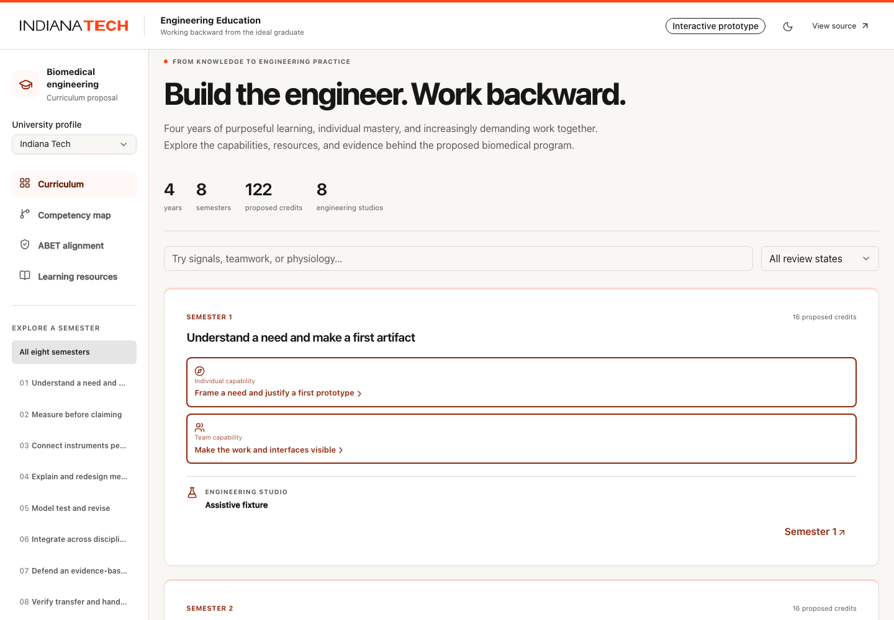

# Review the biomedical education proof of concept

Open [the prototype](https://horner.github.io/edu-eng/). This is a proposal to discuss with Indiana Tech, with a separate official catalog baseline. It is not an approved replacement curriculum or an accreditation determination. The interface requires no account.

Review captures also show the [dark theme](review/dark-theme.png), [four-year map](review/competency-map.png), [focused dependencies](review/dependency-map.png), and [phone layout](review/mobile-semester.png). They illustrate the tested prototype, not student attainment.

## Suggested ten-minute walkthrough

1. Inspect the eight semesters. Open Semester 1 and its individual capability. Then choose the calculus learning area to follow its prerequisite path and one learning resource. Read the resource's access notes, practice, inspection scope, and limitations.
2. Open the studio. Examine problem decomposition, interface agreements, role rotation, experiments, root-cause investigation, individual defense, and separate individual/team rubrics. Repeat in a later semester to see increasing independence.
3. Switch to the competency map. Start with the graduate goal and four year stages; open a semester to see individual/team capabilities, the studio and collapsed foundations. A selected capability retains the same ID and detail across views. Choose **Explore dependencies** to see only that area and its immediate prerequisites. Earlier layers and related/concurrent links are optional; the ordered list is an alternative to the diagram. Use **Back to semester** or **All four years** to return to context.
4. Open Semester 5 for signals, transport and biomaterials, and Semesters 7–8 for the capstone. Follow a resource into a concrete activity and the expected performance evidence.
5. Open ABET alignment. Review all seven outcomes, learning progression, credit allocation and biomedical clauses. The living-system measurement requirement and institutional evidence gaps remain visible.
6. In My notes, record an observation or self-reported activity. Refresh, export a backup, and optionally restore it. These actions do not certify mastery or upload student data.
7. Select Example University and change the theme. The same academic IDs remain; the institution is explicitly fictional. Use a phone or keyboard to check the exploration experience.

## Questions for academic discussion

- Does the proposed graduate capability reflect what employers, faculty and students need?
- Where is the proposed technical depth or prerequisite scaffolding insufficient?
- Would the studio evidence reveal successful collaboration, including integration and failure analysis, rather than only ceremony attendance?
- Are individual explanations, transfer tasks and rubrics sufficient to distinguish each student's competence from team output?
- How should credit-bearing experiences map to the current approved requirements, broad education, laboratories and electives?
- Which living-system measurement experience, faculty expertise, facilities and oversight would be needed for a pilot?
- What small pilot and comparison method would provide useful learning-outcome evidence?

## Evidence and limits

Read the [ABET audit](abet-audit.md), [resource audit](resource-audit.md), [current catalog source note](sources/indiana-tech-bme-2026-2027.md), [implementation plan](../bioprototype-plan.md), and [developer guide](developer-guide.md).

The source contains the proposed eight-term program, 24 biomedical learning areas, 16 capabilities, eight studios and 16 assessments. Resources include inspected reading/course portions and separately labeled video candidates or transcript reviews. Source inspection is bounded; faculty approval and observed educational effectiveness are pending.

The curriculum is backed by a pinned Knowledge Navigator catalog and readable YAML changes. Contributors can demonstrate a resource-only change with `pnpm data:build` and a synthetic conflicting upstream update with `pnpm sync:demo`. Both operations preserve stable IDs and show changes for review.

Feedback from this review should enter the [follow-up backlog](follow-up-backlog.md) with an owner, specific evidence and acceptance condition. The prototype can support that discussion; no faculty feedback or institutional adoption is presumed.
